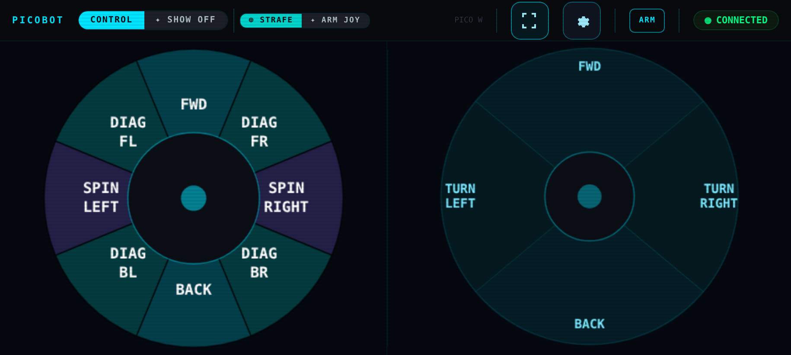

# picobot-joystick-control

**Erasmus+ project ROBO STEAM ACADEMY** (KA220-VET-7CF4F308) — co-funded by the European Union — <https://robosteam.eu/>

Part of the **PicoBot Teachers' Toolkit** (lesson plans, student materials, slides and guides in five languages):
<https://github.com/robosteamdev/robo-steam-academy-teachers-toolkit>

**Joystick control for PicoBot** — the advanced control program of the **Master Control** competition. The robot creates
its own Wi-Fi network and serves a joystick web page; the phone talks to the robot over a **WebSocket**. The program runs
several tasks at once (asyncio) and has safety features: the robot starts **disarmed**, **STOP** always works, a
**deadman** timer stops the motors when the page stops sending, and the page receives **telemetry** (mode, speeds, arm
angles, distance). It also has 10 "show-off" moves.

## What you need

- A **PicoBot** (Raspberry Pi Pico 2 W or Pico W, mecanum wheels, arm), built and checked with
  <https://github.com/robosteamdev/picobot-setup>.
- **MicroPython** on the Pico and **Thonny** (<https://thonny.org>) or `mpremote` on the computer.
- A phone (held sideways) or a laptop with Wi-Fi and a web browser.

## Folders

| Folder / file | Contents |
|---|---|
| `pico/` | everything that goes onto the Pico: `main.py` and the folder `PicoBot/` (program modules, settings `config.py`, web page `www/index.html`) |
| `PICO_UPLOAD_MANIFEST.md` | exactly which files go onto the Pico |
| `HARDWARE_MAP.md` | pins, I2C buses and servo / motor channels |
| `PROTOCOL_V1.md` | the WebSocket messages between page and robot |
| `tests/` | small tests (wheel map, servo channels, protocol test page) |
| `tools/` | notes: uploading, compiling to `.mpy`, serial debugging, manual test commands, backup |

## Install

1. Open `pico/PicoBot/config.py` and set **your team's Wi-Fi name** (`WIFI_SSID`) and password (`WIFI_PASSWORD`,
   at least 8 characters). Every robot with the same name creates the same network — each team needs its own.
2. Check the **servo limits** in `config.py` (`SERVO_BASE_MIN` … `SERVO_CLAW_MAX`) against your robot (see
   `HARDWARE_MAP.md`); the arm must not hit the robot or the floor.
3. Copy the files to the Pico **in the same structure as in `pico/`**: `main.py` into the main folder, the folder
   `PicoBot/` (with `www/`) next to it. The list is in `PICO_UPLOAD_MANIFEST.md`; with Thonny use View → Files and
   **Upload to /** (details and `mpremote` commands: `tools/upload_to_pico.md`).
4. Restart the robot, connect the phone to the robot's Wi-Fi and open **http://192.168.4.1/**.
5. Press **ARM**, then drive. **STOP** stops the robot at once.
6. Check the **arm joystick** with the wheels lifted: pushing it right must turn the arm to the right, pushing it up
   must lift the arm. If a direction is reversed on your robot (servos can be mounted the other way), open
   `pico/PicoBot/www/index.html` and change the two lines `AJ_BASE_DIRECTION` and `AJ_ARM_DIRECTION` at the very top of the
   script from `-1` to `+1` (or the other way round); the comments there explain which line does what. Upload the file again.

## Safety

- **Test with the wheels lifted** first, at low speed.
- The robot starts disarmed and disarms again when the page loses the connection or is hidden.
- `DEADMAN_MS` in `config.py` is the time without drive messages after which the motors stop.
- Keep fingers away from the gripper; power the servos from their own supply (not from the Pico).

## In the toolkit and the competitions

- Module **M12** Capstone, session 28 (Capstone B, Master Control): the simple web control
  (<https://github.com/robosteamdev/picobot-web-control>) and, as an extension, this joystick program.
- Competition platform: <https://competitions.robosteam.eu/>

## Licence and credits

Code: MIT licence (see `LICENSE`). Please credit "ROBO STEAM ACADEMY, Erasmus+ project KA220-VET-7CF4F308" —
<https://robosteam.eu/>

Funded by the European Union. Views and opinions expressed are however those of the author(s) only and do not
necessarily reflect those of the European Union or the Human Resource Development Centre (HRDC). Neither the European
Union nor the granting authority can be held responsible for them.
